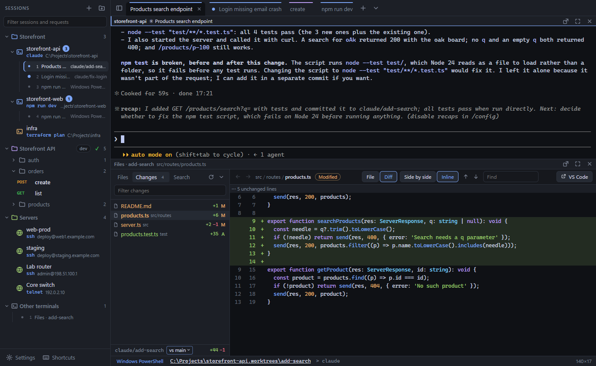

# Shellman

**[shellman.app](https://shellman.app)** · [Download for Windows](https://github.com/mahtinen/shellman/releases/latest/download/Shellman-setup.exe) · MIT license



A lightweight Windows terminal manager built around **saved directories**. Each entry in the session
sidebar means "open a terminal in this folder and (optionally) run this command", for example
`C:\Projects\my-api` + `claude`. One click opens a new Claude Code session there.

Built with Rust ([Tauri 2](https://tauri.app) + [portable-pty](https://crates.io/crates/portable-pty) over
Windows ConPTY) and [xterm.js](https://xtermjs.org) with GPU rendering. The app is a 5 MB exe (2 MB
installer) and uses the WebView2 runtime that ships with Windows 11.

## Features

- **Session sidebar.** Saved directories with optional startup command, shell, colour, environment
  variables and groups. Click opens a new tab; the hover buttons or middle-click open it as a split.
  Drag to reorder or move between groups. "Open all in tabs" on a group starts your whole workspace.
  New sessions start out in your home directory (or the default directory from Settings).
- **Open terminals tree.** Each session lists its open terminals underneath it: the ones opened from it, plus
  any other terminal sitting in its directory. Click one to jump to its tab, middle-click to close it,
  right-click for more. The chevron next to a session collapses its list, like a group, and the state is
  saved. Terminals outside every session directory are listed under "Other terminals" (also collapsible).
- **Any shell, any time.** Open a session with a different shell from the ▾ hover button or "Open with
  shell" in its menu. To change the shell of a running terminal, click the shell name in the status bar or
  use "Switch shell" in the terminal menu. It restarts in the same directory. "New tab here with" opens
  another shell next to it.
- **Splits and tabs.** Split right/down to any depth, drag dividers (double-click resets), maximize a
  pane, move focus with Alt+arrows, drag tabs to reorder. A tab has the same name as its terminal in the
  sidebar: Claude's task title if there is one, otherwise the session's name. Tabs shrink and cut their
  names as more of them open (hover for the full name).
- **Picks up where you left off.** Tabs, splits and each terminal's folder are reopened on the next start,
  with startup commands run again (Settings → Terminal → On start can reopen plain shells or nothing).
  The screen contents aren't restored.
- **"Same directory" everywhere.** New tab, splits and duplicate all start in the *current* directory
  of the active terminal. Shell integration makes PowerShell, cmd, Git Bash and WSL report `cd`
  (OSC 9;9 / OSC 7).
- **Made for Claude Code.**
  - Shift+Enter inserts a newline.
  - Ctrl+V forwards to Claude when the clipboard holds an image.
  - Background tabs show when a session is producing output or has finished.
  - Bells and OSC 9 / OSC 777 notifications flash the taskbar and show a toast.
  - Closing a pane, tab or the window warns if a program (like `claude`) is still running.
- **Quick open** (Ctrl+Shift+P): fuzzy-search saved sessions; Enter = tab, Ctrl+Enter = split right,
  Shift+Enter = split down.
- **Other terminal features.** Find (Ctrl+Shift+F), clickable links (Ctrl+Click), copy on select, right-click paste,
  Ctrl+wheel zoom, six themes, custom shells.

## Install

Download [Shellman-setup.exe](https://github.com/mahtinen/shellman/releases/latest/download/Shellman-setup.exe)
from the latest release (per-user install, no admin needed). The installer isn't code-signed yet, so
SmartScreen may ask you to confirm (More info → Run anyway). If you build it yourself, the installer is in
`src-tauri\target\release\bundle\nsis\`.

Settings and sessions are stored in `%APPDATA%\app.shellman.desktop\config.json`. Every save also keeps
the previous version as `config.json.bak`.

### Updates

Shellman checks GitHub Releases (`github.com/mahtinen/shellman`) 15 seconds after it starts and then every
4 hours. By default a new version downloads in the background, and a **Restart to update** button appears in
the tab bar. If you don't restart, the update installs when you close Shellman, and the next start runs the
new version. Settings → Updates can switch this to "tell me when a new version is out" or turn checks off.
Only installers signed with the project's update key are accepted.

## Keyboard shortcuts

| Action | Keys |
|---|---|
| Quick open saved session | Ctrl+Shift+P |
| New tab in current directory | Ctrl+Shift+T |
| Split right / down (current directory) | Ctrl+Shift+E / Ctrl+Shift+O |
| Duplicate pane (re-runs its command) | Ctrl+Shift+D |
| Close pane | Ctrl+Shift+W |
| Maximize / restore pane | Ctrl+Shift+Z |
| Equalize panes | Ctrl+Shift+Q |
| Move focus | Alt+←↑→↓ |
| Next / previous tab | Ctrl+Tab / Ctrl+Shift+Tab |
| Go to tab 1–9 | Alt+1…9 |
| Find | Ctrl+Shift+F |
| Save pane as session | Ctrl+Shift+S |
| Rename tab | Ctrl+Shift+R (or double-click the tab) |
| Toggle sidebar | Ctrl+Shift+B |
| Settings | Ctrl+, |
| Copy / paste | Ctrl+C (with selection) / Ctrl+V, or Ctrl+Shift+C / Ctrl+Shift+V |
| Paste with the mouse | Right-click (Settings can switch it to "copy selection, otherwise paste" or "show menu") |
| Terminal menu (split, save as session, find…) | Shift+Right-click |
| Select text in Claude Code | Shift+drag |

No shortcut uses Ctrl+Alt, because that's AltGr on Nordic and other European layouts (AltGr+2 = @).

### Claude Code tips

- To get notified when Claude finishes or needs input, set Claude Code's notification channel to the
  terminal bell (`/config`). Shellman then marks the tab and flashes the taskbar when Shellman isn't focused.
- Session commands like `claude --continue` or `claude --resume` are handy for picking up where you
  left off.

## Development

Requirements: Rust (stable, MSVC toolchain), the VS C++ Build Tools with a Windows SDK, and Node 20+.

```powershell
npm install
npm run app:dev        # run with hot reload
npm run app:build      # signed release exe + NSIS installer + latest.json
npm run release -- 0.2.0 --notes "What changed"   # start the Release workflow on GitHub
npm test               # frontend unit tests (vitest)
npm run test:rust      # Rust unit + real ConPTY integration tests
npm run e2e            # drives the release build through WebView2 DevTools (see e2e/)
```

`npm run e2e` moves your real config aside while it runs and restores it afterwards.

### Releasing

Releases are built and published by GitHub Actions, never from a developer's machine:

1. Push to `main` (or merge a pull request). The **CI** workflow type-checks, builds the frontend and runs the
   unit and Rust tests. Run `npm run e2e` locally too; it needs a real desktop and the `claude` CLI, so it
   can't run in CI.
2. Start a release from **Actions → Release → Run workflow** and enter the version (e.g. `0.2.0`). From a
   terminal, `npm run release -- 0.2.0 [--notes "What changed"]` does the same, and pushing a tag `v0.2.0`
   works too.
3. The **Release** workflow checks that the version is newer than the latest release and that CI passed for
   that commit. It stamps the version into the build, signs the installer for the updater, and publishes
   release `v0.2.0` with the installer, its `.sig`, `latest.json` and `Shellman-setup.exe`. Without notes,
   GitHub lists the changes since the last release.

Installed copies poll `releases/latest/download/latest.json`, so publishing the release is all it takes.
The version in the repository files isn't bumped; the release tag decides the version.

**Signing key.** The updater key lives in the `TAURI_SIGNING_PRIVATE_KEY` secret of the `release`
environment (Settings → Environments). Its public half is in `src-tauri/tauri.conf.json`. Keep an offline
backup: if it's lost, installed copies can't verify new versions and everyone has to reinstall by hand.
`npm run app:build` can still make a signed build locally from `%USERPROFILE%\.tauri\shellman.key`.

**Branch protection.** `main` can't be force-pushed or deleted, and pull requests need a passing CI run
(admins can push directly). Release tags `v*` can't be moved or deleted.

### Layout

| Path | What |
|---|---|
| `src-tauri/src/pty.rs` | ConPTY sessions: reader/writer/waiter threads, UTF-8 streaming, child-process detection |
| `src-tauri/src/shell.rs` | Shell detection and launch arguments (startup commands, shell integration) |
| `src-tauri/src/config.rs` | Atomic config persistence with backup and corrupt-file quarantine |
| `src/workspace.ts` | Tabs, split layout rendering, focus, activity tracking, GPU budget |
| `src/pane.ts` | One terminal: xterm.js, input/clipboard handling, OSC parsing, search |
| `src/layout.ts` | Pure split-tree operations (unit tested) |
| `src/sidebar.ts`, `sessionEditor.ts`, `settingsDialog.ts`, `palette.ts` | UI |
| `src/updater.ts` | Background update checks, download and install-on-restart |
| `.github/workflows/` | CI checks and the Release workflow |
| `scripts/build.mjs`, `set-version.mjs`, `release.mjs` | Signed build + `latest.json`, version stamping, starting a release |
| `docs/` | The [shellman.app](https://shellman.app) website (GitHub Pages) |

Startup commands are never spliced into a command line. PowerShell gets them as `-EncodedCommand`, and
cmd/bash/WSL read them from an environment variable. That way quotes, `&`, `$` and non-ASCII paths
behave exactly as typed.

## Not done yet

- Terminal contents (scrollback) aren't restored after a restart; tabs, splits and folders are.
- Shortcuts aren't configurable yet (see `src/keys.ts`).
- Windows only.
